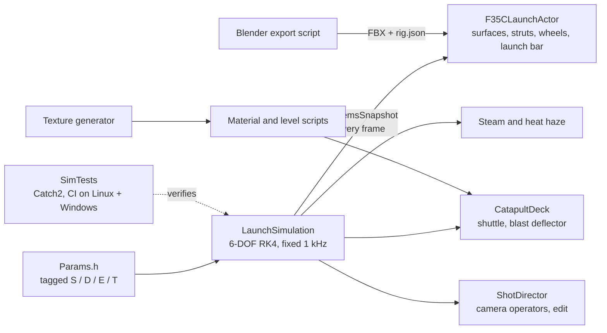

# F-35C Catapult Launch

An F-35C catapult launch off a Nimitz-class carrier, simulated in C++ and rendered in
real time in Unreal Engine 5.5.


**[▶ Watch the full video (1080p)](Docs/Media/launch.mp4)** ·
[Slow motion](#slow-motion) · [How it works](#how-it-works) ·
[Physics notes](Docs/LaunchModel.md) · [Camera notes](Docs/Cameras.md)

I wanted to see how close real-time graphics could get to actual Navy launch footage.
The scene is based on the F-35C's first carrier trials aboard USS Nimitz in November
2014. Nothing in the launch is keyframed: a physics simulation I wrote moves the jet,
the catapult shuttle, the landing gear, the steam and the cameras. The timing, speeds
and deck procedure come from published sources.

| | |
|---|---|
|  |  |
|  |  |

## Slow motion


The catapult stroke at quarter speed ([video](Docs/Media/slowmo.mp4)). You can see the
nose bob as the nose-gear strut oscillates under the launch bar, and the steam coming
up out of the track behind the shuttle.

This isn't slowed-down footage. I re-recorded the launch at 120 frames per second of
simulated time. The physics runs on fixed time steps and the cameras run on simulation
time, so recording more frames gives the same launch in slow motion.

## How it works

### Research first

Before writing any code I researched the 2014 trials (VX-23), the C-13-1 steam
catapult, the launch procedure and crew signals, F-35C weights and dimensions, and how
real launch footage is shot. Every number the simulation uses lives in one file,
[`Params.h`](Source/LaunchSim/Public/LaunchSim/Params.h), tagged with where it came from:

| Tag | Meaning |
|---|---|
| **[S]** | Sourced from published material |
| **[D]** | Derived from sourced values by calculation |
| **[E]** | Engineering estimate: plausible but unpublished |
| **[T]** | To be tuned against frame-timed Navy footage |

Some values, like peak g and the holdback release load, were never published. Those are
marked as estimates, and I plan to tune them by timing frames in Navy footage.

### The physics

The launch simulation in [`Source/LaunchSim/`](Source/LaunchSim) is plain C++20 with no
Unreal code, so it builds and tests on its own. It's a six-degree-of-freedom rigid body
stepped at a fixed 1 kHz with RK4. It models the landing-gear struts, the launch bar and
holdback, the 94.4 m catapult stroke, the aerodynamics including ground effect over the
deck, and the flight control system rotating the jet once it's off the bow. Time is
kept in integer nanoseconds, so the same inputs give bit-identical results at any frame
rate.

Unreal reads one snapshot of the simulation each frame and poses everything in the
scene from it:



### Testing against the research

I turned the research targets into [13 automated tests](SimTests/test_launch.cpp).
GitHub Actions runs them on Linux and Windows on every push, without Unreal.

| What's checked | Simulated | Target |
|---|---|---|
| Stroke time | 2.54 s | 2.2 to 2.8 s for a 94.4 m stroke |
| End speed, deck-relative | 134 kt | 135 kt commanded |
| Peak longitudinal acceleration | 3.2 g | 3.0 to 4.6 g |
| Holdback release after the valve opens | 0.06 s | under 0.2 s |
| Nose-strut oscillation on the stroke | 4+ reversals | documented F-35C behavior |
| Sink off the bow | 1.4 m | little or none (under 3 m) |
| Rotation | 12° climb attitude | 12° ± 3° |
| Replays | bit-identical | bit-identical at any frame rate |

<picture>
  <source media="(prefers-color-scheme: dark)" srcset="Docs/Media/telemetry_dark.png">
  
</picture>

The nose-gear panel shows the vertical oscillation reported in F-35C catapult testing.
The launch bar is angled, so the catapult pulls the nose down while the acceleration
pitches it up. To regenerate the chart, run `launchsim_telemetry` and then
[`Tools/Plots/plot_telemetry.py`](Tools/Plots/plot_telemetry.py).

### Everything is built by scripts

I didn't place anything in the editor by hand. Scripts generate the textures, build the
materials, convert the aircraft model and lay out the level, so every setting is in git
and the whole scene can be rebuilt from scratch.

| Script | What it does |
|---|---|
| [`Tools/Blender/export_f35_parts.py`](Tools/Blender/export_f35_parts.py) | Rescales the aircraft model, splits it into moving parts and writes their hinge lines to `rig.json` |
| [`Tools/Textures/generate_textures.py`](Tools/Textures/generate_textures.py) | Non-skid deck, wear and rubber masks, sea and haze normals, steam sprites |
| [`Tools/Editor/build_materials.py`](Tools/Editor/build_materials.py) and [`build_deck_and_effects.py`](Tools/Editor/build_deck_and_effects.py) | The material graphs |
| [`Tools/Editor/build_launch_level.py`](Tools/Editor/build_launch_level.py) | Sun, sky, fog, clouds, sea, deck, aircraft and cameras |

### Cameras

Perfectly smooth CG cameras are one of the main things that make launch videos look
fake, so I wrote a [shot director](Docs/Cameras.md) that simulates the camera operators
instead. Each operator reacts a little late, so they fall behind the jet when it
accelerates at 3 g and overshoot when they catch up. Handheld cameras wander, the
deck-level cameras shake when the catapult fires, and the whole ship slowly rolls and
pitches. Exposure is locked at f/8, 1/200 s, ISO 100 like a real camera, and the edit
cuts on the same beats Navy launch videos usually do.

### Progress


Problems I ran into along the way:

- **The first renders were 4 stops overexposed.** Unreal's cine camera ignores the
  aperture for exposure unless manual focus is on. Once I turned it on, I set exposure
  for a sunlit dark deck (EV100 ≈ 13.6).
- **The catapult force was right but the end speed was wrong.** The shuttle pulls
  horizontally while the launch bar is angled, so I modeled the bar as a two-force link
  that carries tow / cos θ. The same geometry turned out to explain the nose squat and
  the strut oscillation.
- **Steam lit from behind rendered almost black.** Lit translucent materials don't
  scatter light forward, so I added a scatter term to the steam material.
- **Strong heat haze looked like soot on the deck.** I turned it down to the subtle
  shimmer you see in daylight footage.
- **Several materials silently fell back to the default material.** The compile errors
  only showed up in the game log. There were four mistakes in the material graphs: an
  alpha mask on a three-channel texture, wrong sampler types, a circular Fresnel input
  and a vector-size mismatch.

## What's not there yet

I think the lighting, the deck, the steam, the launch timing and the camera work hold
up. These are what still give it away, biggest first:

1. **The aircraft.** It's a low-detail F-35B game model that I re-rigged and re-textured
   as a stand-in. A high-detail F-35C (see [ASSETS.md](ASSETS.md)) would drop straight
   into the same rig.
2. **No deck crew yet.** The shooter, hookup crew and checkers need character models and
   signal animations.
3. **The ship and the sea.** The ship is a simple hull block under the deck section I
   built, and the sea is a flat plane with wave normals. A carrier model and an FFT
   ocean are the next upgrades.
4. **Heat haze** is deliberately subtle and still needs tuning.

## Repo layout

```text
Source/LaunchSim/      launch physics, pure C++20 (no Unreal dependency)
Source/F35CLaunch/     Unreal module: aircraft rig, deck, steam, haze, shot director
SimTests/              CMake + Catch2 tests and the telemetry tool
Tools/                 Blender, texture, material, level and plotting scripts
Docs/                  physics model, cameras, render settings, references, media
Content/               generated materials, textures and the level (Git LFS)
```

## Building it

**Unreal project:** You need Unreal Engine 5.5.4 and Visual Studio 2022 with the MSVC
14.38.33130 toolset. Right-click `F35CLaunch.uproject`, choose *Generate Visual Studio
project files*, then build `F35CLaunchEditor`. The third-party aircraft model isn't in
the repo (see [ASSETS.md](ASSETS.md)); without it the project still builds and runs with
a blockout aircraft.

**Physics tests and telemetry** (any platform, no Unreal needed):

```bash
cmake -S SimTests -B SimTests/build
cmake --build SimTests/build --parallel
ctest --test-dir SimTests/build --output-on-failure
SimTests/build/launchsim_telemetry telemetry.csv
```

**Recording a video:** see [Docs/Cameras.md](Docs/Cameras.md#recording).

## Licensing

My code and original content are [MIT](LICENSE) © 2026 nefariousjosiah. Third-party
models are used under their own licenses and aren't included in the repo; see
[ASSETS.md](ASSETS.md) and [ATTRIBUTION.md](ATTRIBUTION.md).

This is an independent portfolio project. It isn't affiliated with, sponsored by or
endorsed by Lockheed Martin, the U.S. Navy or the U.S. Department of Defense. No
official logos are used.
