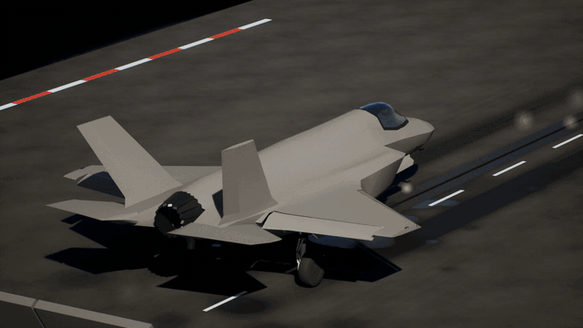
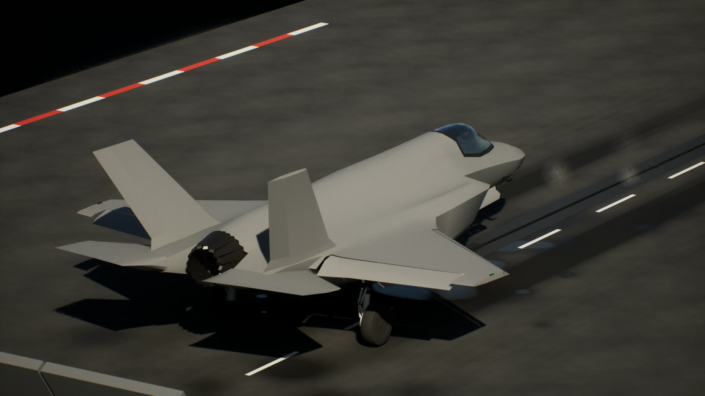
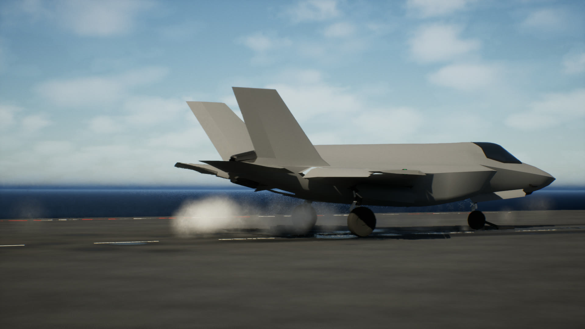
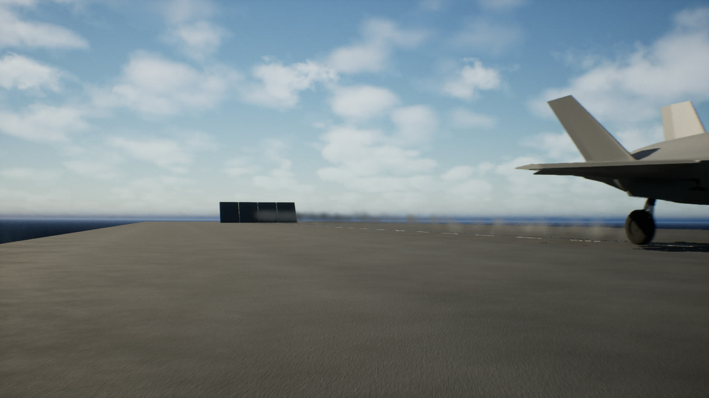
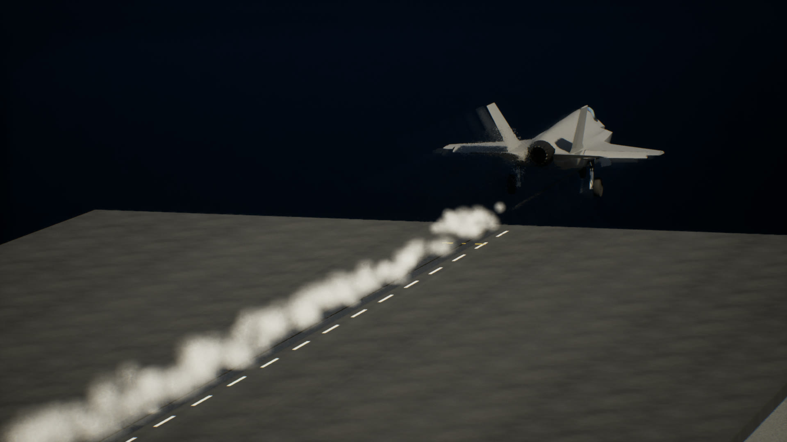
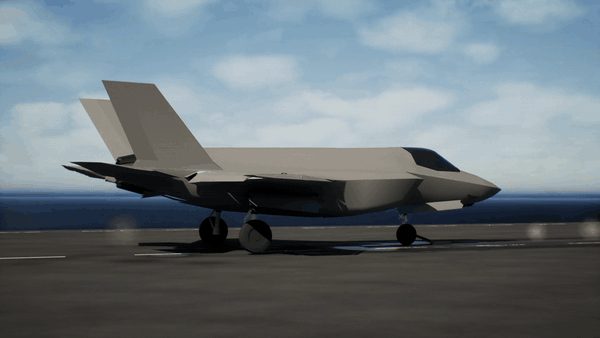
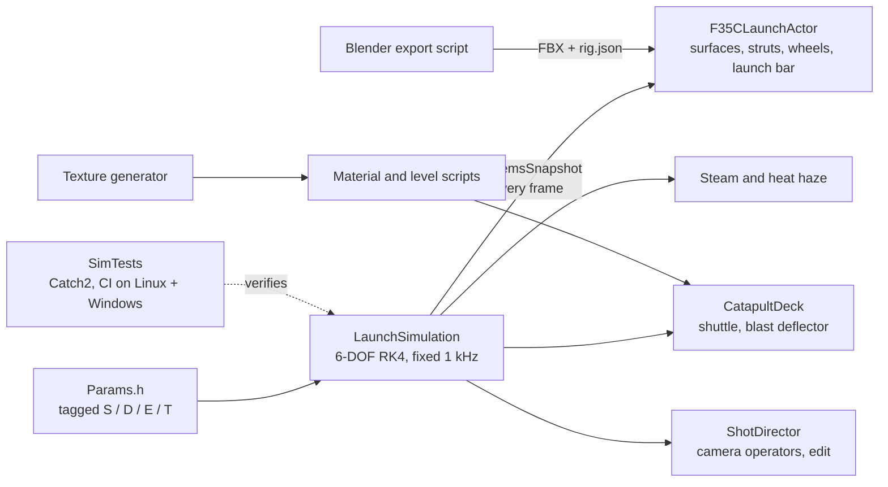
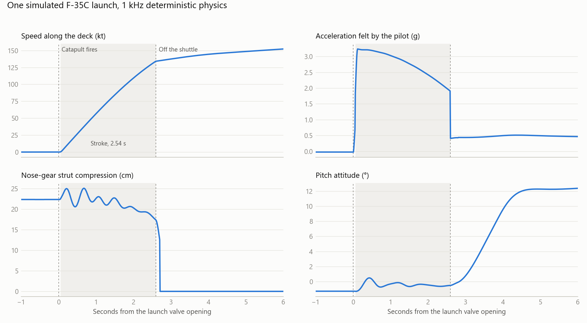
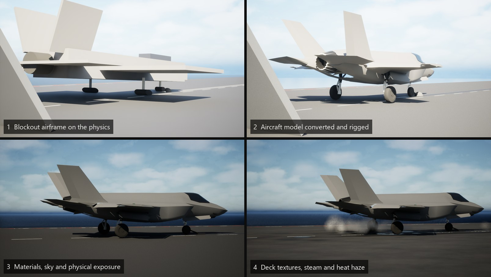

# F-35C Catapult Launch

A real-time recreation of an F-35C steam-catapult launch from a Nimitz-class carrier,
modelled on the jet's first carrier sea trials aboard USS Nimitz in November 2014.
Built in Unreal Engine 5.5 with C++: a deterministic 6-DOF launch simulation drives the
aircraft, the catapult, the effects and the cameras.



**[▶ Full video, 1080p (Docs/Media/launch.mp4)](Docs/Media/launch.mp4)** ·
[Slow motion](#slow-motion) · [How it was built](#how-it-was-built) ·
[Physics](Docs/LaunchModel.md) · [Cameras](Docs/Cameras.md)

The aim is a shot that passes for real footage, so everything a viewer checks is
taken from published sources:

- the deck crew's signal sequence;
- the ~2.5 s, 94 m catapult stroke;
- satin FS 36170 grey;
- heat shimmer instead of flame in daylight;
- steam blowing aft;
- handheld cameras exposed for the dark deck.

| | |
|---|---|
|  |  |
|  |  |

## Slow motion



The stroke at quarter speed, from the deck camera to the bow camera. Watch the nose bob
as the strut oscillates under the launch bar, and the steam unzip behind the shuttle.
[Video](Docs/Media/slowmo.mp4).

This is not interpolated: the take was re-recorded at 120 simulated frames per second.
The simulation and every camera run on simulation time, so a slower frame rate produces
the same launch with more frames.

## How it was built

### 1. Research before code

The project started with a research brief:

- the 2014 Nimitz trials (VX-23, DT-I);
- the C-13-1 catapult;
- the deck procedure and crew signals;
- F-35C weights and geometry;
- what real launch footage looks like, down to lenses and exposure.

Every number that shapes the launch lives in one header,
[`Params.h`](Source/LaunchSim/Public/LaunchSim/Params.h). Each one is tagged with where
it came from:

| Tag | Meaning |
|---|---|
| **[S]** | Sourced from published material |
| **[D]** | Derived from sourced values by calculation |
| **[E]** | Engineering estimate: plausible but unpublished |
| **[T]** | To be tuned against frame-timed Navy footage |

Peak g, holdback release load and strut rates were never published, so they are
estimates with a calibration plan, not invented facts.

### 2. Physics as its own engine-free module



[`Source/LaunchSim/`](Source/LaunchSim) is plain C++20 with no Unreal dependency. It
contains:

- a rigid body stepped at a fixed 1 kHz with RK4 in the deck frame;
- an integer-nanosecond time accumulator, so the frame rate can never change the result;
- nonlinear air-oil landing-gear struts;
- the launch bar as a two-force link and the holdback as a tension-only link;
- a front-loaded 94.4 m catapult stroke;
- aerodynamics with ground effect that is lost at the bow;
- the hands-off flight-control rotation.

Unreal only reads one `SystemsSnapshot` per frame. The same module builds standalone
with CMake for the tests.

### 3. Requirements as acceptance tests

The research targets became [13 acceptance tests](SimTests/test_launch.cpp). They run in
[CI](.github/workflows/ci.yml) on every push, without Unreal:

| Requirement | Simulated | Target |
|---|---|---|
| Stroke time | 2.54 s | 2.2 to 2.8 s for a 94.4 m stroke |
| End speed, deck-relative | 134 kt | 135 kt commanded |
| Peak longitudinal acceleration | 3.2 g | 3.0 to 4.6 g |
| Holdback release after the valve opens | 0.06 s | under 0.2 s |
| Nose-strut oscillation on the stroke | 4+ reversals | documented F-35C behaviour |
| Sink off the bow | 1.4 m | little or none (under 3 m) |
| Rotation | 12° climb attitude | 12° ± 3° |
| Replays | bit-identical | bit-identical, any frame-time chunking |

<picture>
  <source media="(prefers-color-scheme: dark)" srcset="Docs/Media/telemetry_dark.png">
  
</picture>

The nose-strut panel shows the vertical oscillation reported in F-35C catapult testing:
the angled launch bar pulls the nose down while acceleration pitches it up. To regenerate the
chart, run `launchsim_telemetry` and then
[`Tools/Plots/plot_telemetry.py`](Tools/Plots/plot_telemetry.py).

### 4. Content as code

Nothing in the scene is hand-placed. Scripts build all of it, so every look-dev value
is reviewable text in git.

| Script | Builds |
|---|---|
| [`Tools/Blender/export_f35_parts.py`](Tools/Blender/export_f35_parts.py) | Rescales the aircraft model, splits it into moving parts and writes their hinge lines to `rig.json` |
| [`Tools/Textures/generate_textures.py`](Tools/Textures/generate_textures.py) | Tileable non-skid, deck wear and rubber masks, sea and haze normals, steam sprites |
| [`Tools/Editor/build_materials.py`](Tools/Editor/build_materials.py) and [`build_deck_and_effects.py`](Tools/Editor/build_deck_and_effects.py) | The material graphs |
| [`Tools/Editor/build_launch_level.py`](Tools/Editor/build_launch_level.py) | Sun, sky, fog, clouds, sea, deck, aircraft and cameras |

### 5. Cameras that behave like people

Most CG launch footage gives itself away with a perfect, weightless camera. The
[shot director](Docs/Cameras.md) operates each camera like a person or a fixed mount:

- a reaction delay, with pan and tilt as an under-damped spring, so the operator lags
  a 3 g launch and overshoots;
- hand wander and the catapult's thump through the deck;
- the ship's roll and pitch, which moves the deck, the jet and the cameras together;
- locked physical exposure (f/8, 1/200 s, ISO 100).

The edit cuts on the same beats as Navy B-roll.

### 6. Iteration



Problems worth knowing about from the build:

- **The camera was 4 stops overexposed.** Unreal's cine camera ignores the aperture for
  exposure unless manual focus is enabled. With focus on, exposure was calibrated to a
  sunlit dark deck (EV100 ≈ 13.6).
- **The end speed was wrong with a correct catapult force.** The shuttle pulls
  horizontally but the launch bar is angled, so the bar is modelled as a two-force link
  carrying tow / cos θ. That same geometry produces the nose squat and the strut
  oscillation.
- **Steam lit from behind rendered nearly black.** Lit translucency doesn't forward-scatter,
  so the steam material has an explicit scatter term.
- **Physically strong heat haze read as soot on the deck.** The refraction is turned down
  to a subtle shimmer, as in daylight footage.
- **Materials that failed to compile fell back silently to the default material.** The
  errors appeared only in the game log. Four graph mistakes were behind them: an alpha
  mask on a three-channel texture, wrong sampler types, a circular Fresnel input and a
  vector-size mismatch.

## Honest status

What reads as real:

- the light and exposure;
- the near-black, weathered non-skid;
- steam unzipping behind the shuttle and trailing aft;
- the launch's timing and physics;
- camera behaviour and cuts.

What still gives it away, in order of impact:

1. **The aircraft model** is a low-detail, third-party F-35B game model, re-rigged
   and re-materialled here. A high-detail F-35C (see [ASSETS.md](ASSETS.md)) drops
   straight into the same rig.
2. **No deck crew.** Shooter, hookup crew and checkers need MetaHumans in jerseys and
   signal animations.
3. **The ship** is a simple hull block under a hand-built deck section, and **the
   sea** is a wave-normal plane. The upgrades are a carrier model and an FFT ocean.
4. **Heat haze** is deliberately subtle; stronger settings read as soot. It wants
   tuning live in the editor.

## Repository layout

```text
Source/LaunchSim/      launch physics, pure C++20 (no Unreal dependency)
Source/F35CLaunch/     Unreal module: aircraft rig, deck, steam, haze, shot director
SimTests/              CMake + Catch2 acceptance tests and telemetry tool
Tools/                 Blender, texture, material, level and plotting scripts
Docs/                  physics model, cameras, render settings, references, media
Content/               generated materials, textures and the level (Git LFS)
```

## Building

**Unreal project:** Unreal Engine 5.5.4 and Visual Studio 2022 with the MSVC
14.38.33130 toolset. Right-click `F35CLaunch.uproject`, choose *Generate Visual Studio
project files*, then build `F35CLaunchEditor`. Third-party art is not in the repo (see
[ASSETS.md](ASSETS.md)). Without it, the project builds and runs with a blockout
aircraft.

**Physics tests and telemetry** (any platform, no Unreal needed):

```bash
cmake -S SimTests -B SimTests/build
cmake --build SimTests/build --parallel
ctest --test-dir SimTests/build --output-on-failure
SimTests/build/launchsim_telemetry telemetry.csv
```

**Recording a take:** see [Docs/Cameras.md](Docs/Cameras.md#recording).

## Assets and licensing

Code and original content: [MIT](LICENSE) © 2026 nefariousjosiah. Third-party models
are used under their own licenses and are not redistributed; see
[ASSETS.md](ASSETS.md) and [ATTRIBUTION.md](ATTRIBUTION.md).

This is an independent portfolio project. It is not affiliated with, sponsored by or
endorsed by Lockheed Martin, the U.S. Navy or the U.S. Department of Defense. The
aircraft and ship are depicted factually; no official logos are used.
